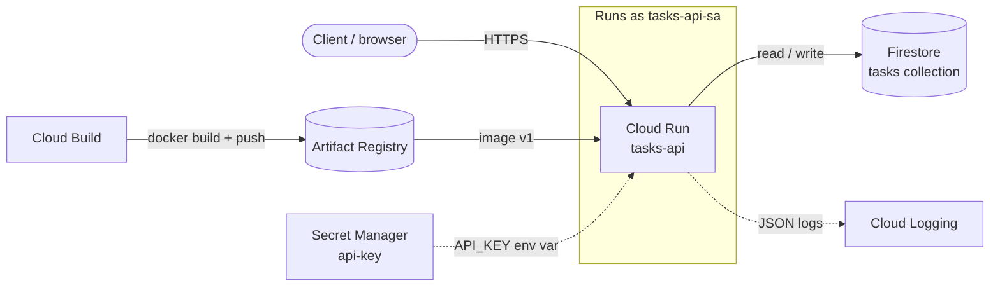
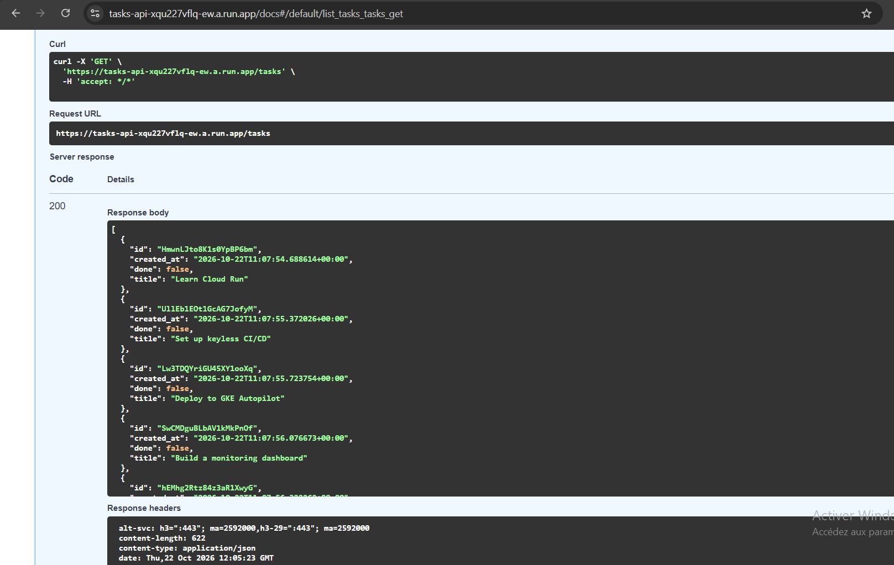
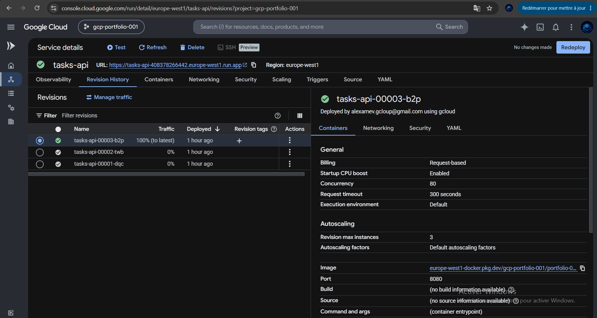
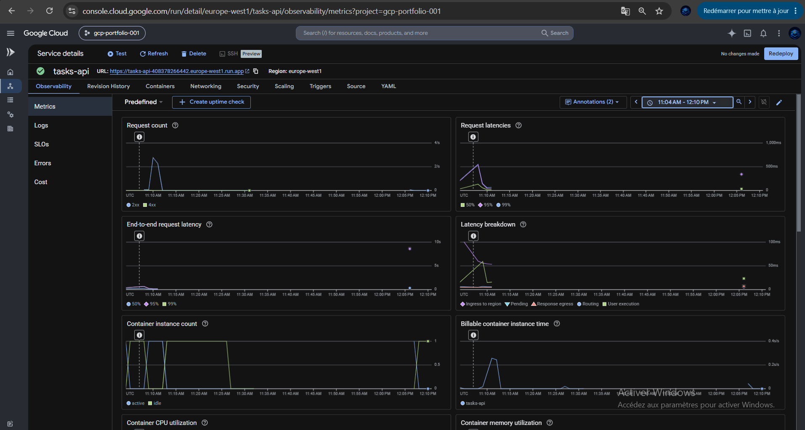
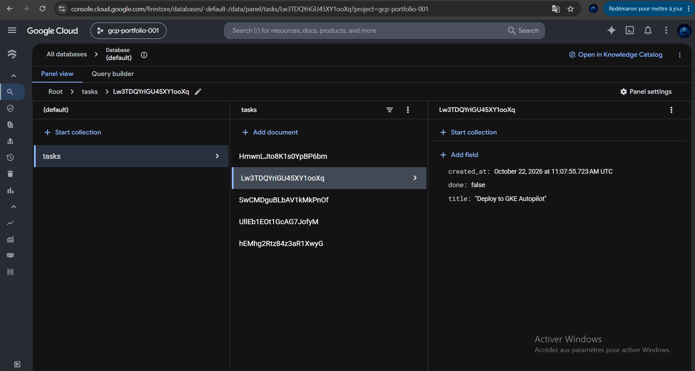
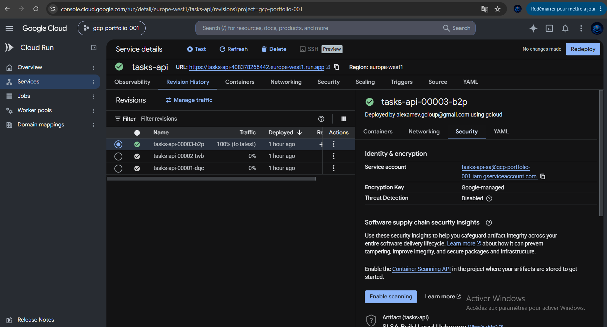

# 01 – Containerized Tasks API on Cloud Run

**Problem:** run a small REST API in production without managing servers, without putting credentials in code, and without paying while it's idle.

**Result:** a FastAPI service on Cloud Run that stores tasks in Firestore. It scales from 0 to 3 instances, reads its API key from Secret Manager at runtime, and runs as a dedicated service account with only two permissions.

**Live demo:** [CLOUD-RUN-URL/docs](https://https://tasks-api-xqu227vflq-ew.a.run.app/docs) (interactive API docs; reads are public, writes need the API key)

---

## Architecture



| Component | Role |
|-----------|------|
| **Cloud Run** | Serverless container runtime, HTTPS endpoint, autoscaling 0 → 3 |
| **Artifact Registry** | Private Docker repository for the image |
| **Cloud Build** | Builds the image in the cloud (no local Docker needed) |
| **Secret Manager** | Stores the API key; injected as an environment variable at startup |
| **Firestore** | Serverless NoSQL database for tasks (free tier) |
| **IAM** | Dedicated service account `tasks-api-sa` with least-privilege roles |

---

## API

| Method | Path | Auth | Description |
|--------|------|------|-------------|
| `GET` | `/health` | – | Liveness check; returns the running Cloud Run revision |
| `GET` | `/tasks` | – | List up to 50 tasks, oldest first |
| `POST` | `/tasks` | `x-api-key` | Create a task `{"title": "...", "done": false}` |
| `DELETE` | `/tasks/{id}` | `x-api-key` | Delete a task |
| `GET` | `/hash?rounds=N` | – | CPU-heavy endpoint used for the autoscaling test in project 4 |
| `GET` | `/debug/error` | `x-api-key` | Returns a deliberate 500, used to test alerts in project 5 |
| `GET` | `/docs` | – | Interactive OpenAPI docs generated by FastAPI |

---

## Deployment

```bash
source ../env.sh

# Build in the cloud and push to Artifact Registry
gcloud builds submit . --tag $IMAGE:v1

# Deploy
gcloud run deploy tasks-api \
  --image=$IMAGE:v1 \
  --region=$REGION \
  --service-account=tasks-api-sa@$PROJECT_ID.iam.gserviceaccount.com \
  --set-secrets=API_KEY=api-key:latest \
  --allow-unauthenticated \
  --min-instances=0 --max-instances=3 \
  --memory=512Mi --cpu=1
```

| Flag | Why |
|------|-----|
| `--service-account` | Runs as a dedicated identity instead of the broad default account |
| `--set-secrets` | Injects the key from Secret Manager; it never appears in code, the image or Git |
| `--min-instances=0` | Scales to zero when idle, so it costs nothing without traffic |
| `--max-instances=3` | Caps cost and blast radius if the endpoint is flooded |
| `--allow-unauthenticated` | Public reads for the demo; writes are protected by the API key |

---

## Security design: dedicated service account + Secret Manager

By default, Cloud Run runs a service as the Compute Engine default service account. In many projects that account holds the broad *Editor* role, which means a bug or a compromised dependency could reach almost any resource in the project. Instead, this service runs as **`tasks-api-sa`**, which has exactly two permissions:

- `roles/datastore.user` on the project, to read and write Firestore and nothing else.
- `roles/secretmanager.secretAccessor` on **the `api-key` secret only**, not on all secrets in the project.

The API key lives in **Secret Manager** rather than in the code, the Dockerfile or a plain environment variable in the deploy command. This keeps it out of Git history and container layers, and every access is recorded in Cloud Audit Logs. Rotating the key is one command (`gcloud secrets versions add`) followed by a new revision, with no code change or rebuild. Applying least privilege this way limits the damage any single failure can cause.

```bash
gcloud iam service-accounts create tasks-api-sa --display-name="Tasks API runtime"

gcloud projects add-iam-policy-binding $PROJECT_ID \
  --member=serviceAccount:tasks-api-sa@$PROJECT_ID.iam.gserviceaccount.com \
  --role=roles/datastore.user

openssl rand -hex 16 | tr -d '\n' | gcloud secrets create api-key --data-file=-

gcloud secrets add-iam-policy-binding api-key \
  --member=serviceAccount:tasks-api-sa@$PROJECT_ID.iam.gserviceaccount.com \
  --role=roles/secretmanager.secretAccessor
```

---

## Try it

```bash
export URL=$(gcloud run services describe tasks-api --region=$REGION --format='value(status.url)')
export KEY=$(gcloud secrets versions access latest --secret=api-key)

curl $URL/health
curl -X POST $URL/tasks -H "x-api-key: $KEY" -H "content-type: application/json" \
     -d '{"title":"Learn Cloud Run"}'
curl $URL/tasks
curl -i -X POST $URL/tasks -H "x-api-key: wrong" -d '{}'      # → 401
```

<details>
<summary>Windows PowerShell equivalent</summary>

```powershell
$URL = gcloud run services describe tasks-api --region=europe-west1 --format='value(status.url)'
$KEY = gcloud secrets versions access latest --secret=api-key
Invoke-RestMethod -Method Post -Uri "$URL/tasks" -Headers @{ "x-api-key" = $KEY } `
  -ContentType "application/json" -Body '{"title":"Learn Cloud Run"}'
Invoke-RestMethod "$URL/tasks"
```
</details>

### Run locally

```bash
gcloud auth application-default login
pip install -r requirements.txt
API_KEY=dev uvicorn main:app --reload      # http://localhost:8000/docs
```

---

## Evidence

### Interactive API docs (`/docs`)


### Cloud Run service: revisions and metrics



### Firestore `tasks` collection


### Runtime identity and secret reference


---

## Project structure

```text
01-cloud-run-api/
├── main.py              # FastAPI app
├── requirements.txt
├── Dockerfile
├── tests/test_api.py    # unit tests (Firestore mocked), run in CI – see project 2
├── docs/                # screenshots
└── README.md
```

---

## What I learned

- **Cloud Run sets the port:** the container must listen on `$PORT`, which is why the Dockerfile uses `--port ${PORT:-8080}`.
- **Secrets are read at instance start:** after adding a new secret version, I had to create a new revision for running instances to pick it up.
- **Hidden characters break secrets:** a trailing newline in a secret makes a string comparison fail silently. I now create secrets with `tr -d '\n'` and `.strip()` the value in code.
- **Structured logging is free observability:** printing one JSON line per event gives searchable `jsonPayload` fields in Cloud Logging, which project 5 turns into metrics.

## What I'd change for production

- Replace the shared API key with real authentication (Identity Platform / Firebase Auth JWTs, or IAM with `--no-allow-unauthenticated`).
- Put an external HTTPS load balancer with Cloud Armor in front for a custom domain, rate limiting and WAF rules.
- Add pagination and input validation limits to `/tasks`.
- Pin dependency versions and scan the image with Artifact Analysis.

---

## Cost & cleanup

At portfolio traffic this costs **$0**: Cloud Run scales to zero, and Firestore, Cloud Build, Artifact Registry and Secret Manager usage stay within free tiers or cost cents.

```bash
gcloud run services delete tasks-api --region=$REGION
gcloud secrets delete api-key
gcloud artifacts docker images delete $IMAGE --delete-tags
gcloud iam service-accounts delete tasks-api-sa@$PROJECT_ID.iam.gserviceaccount.com
```
<!-- pr gate test -->
