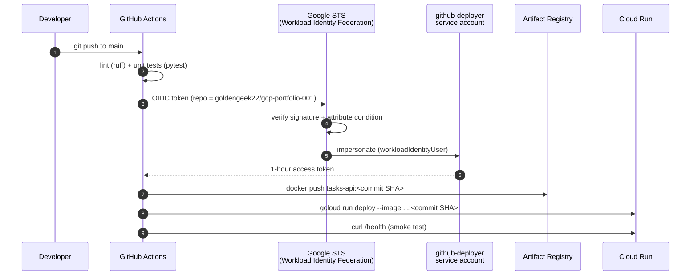
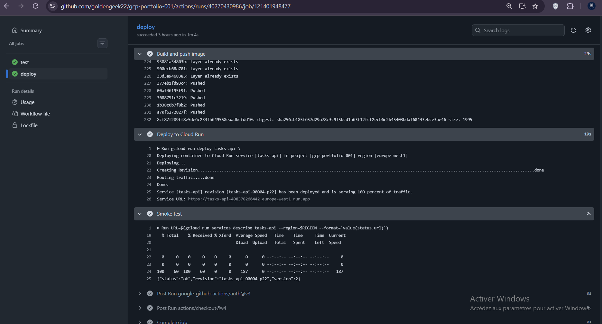
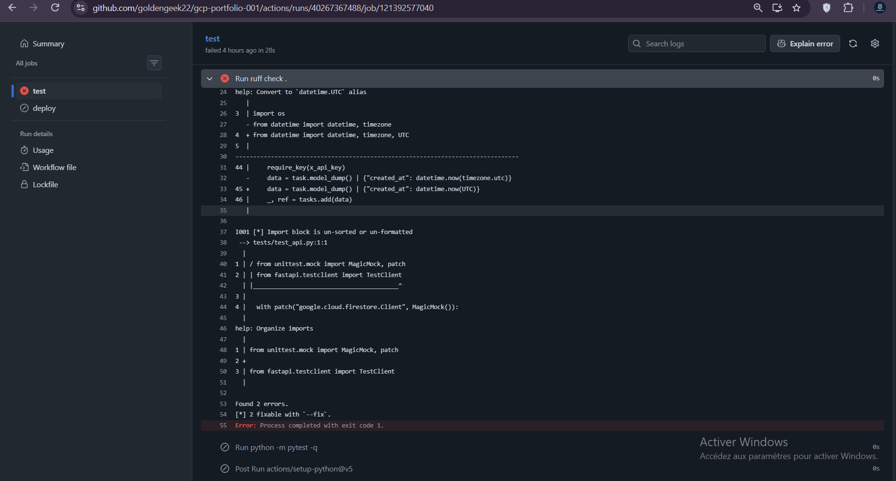
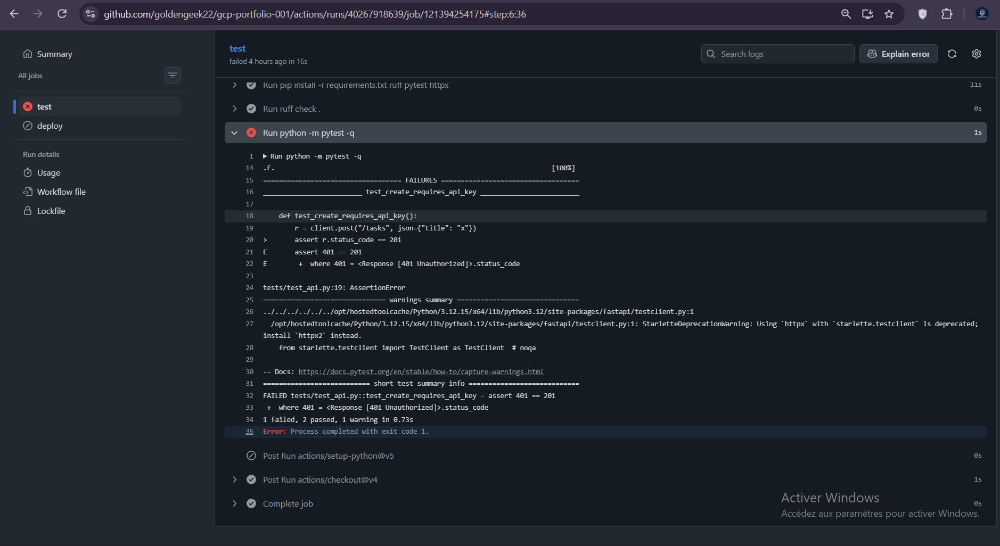
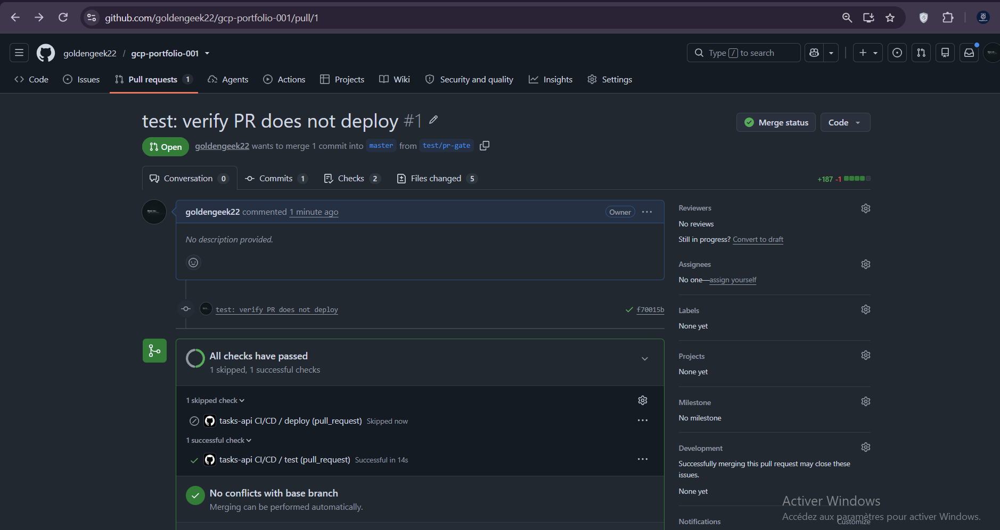
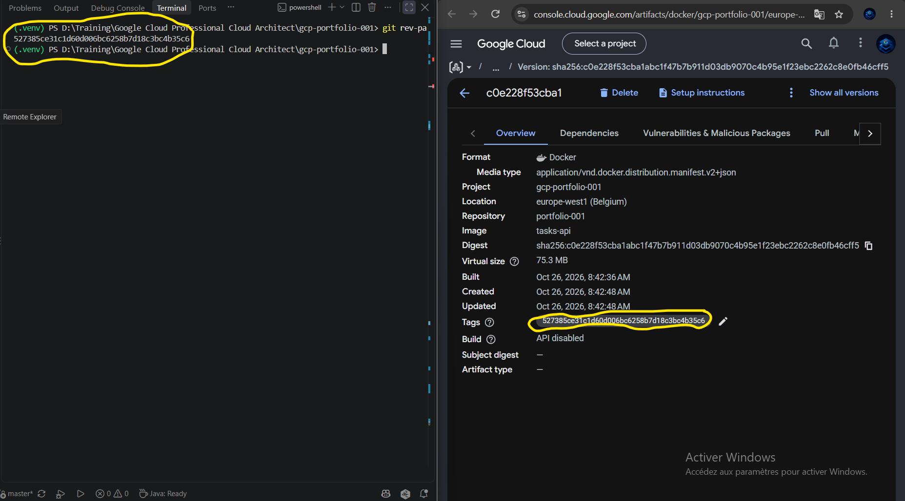
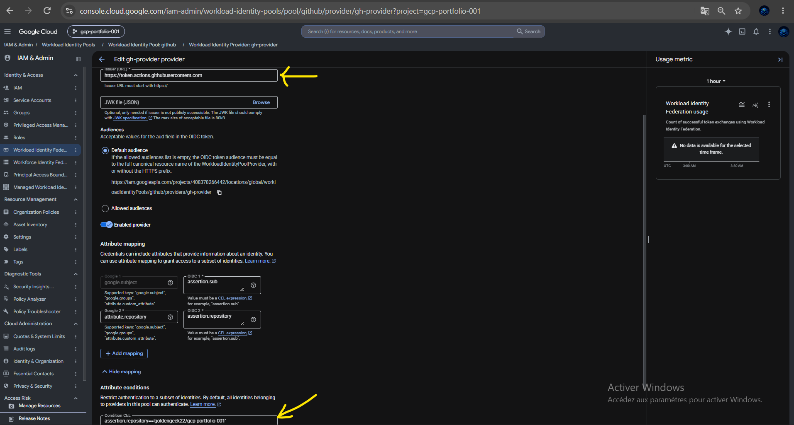
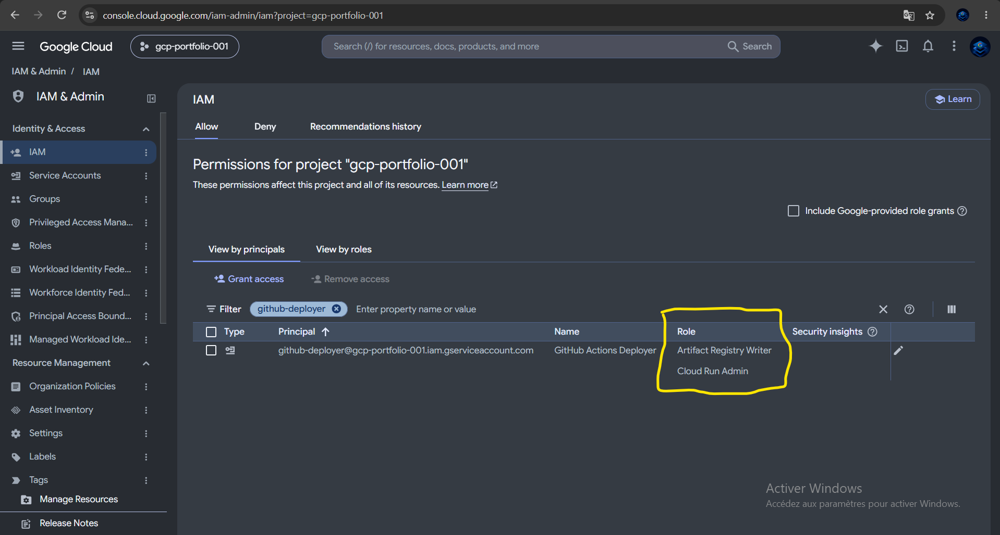
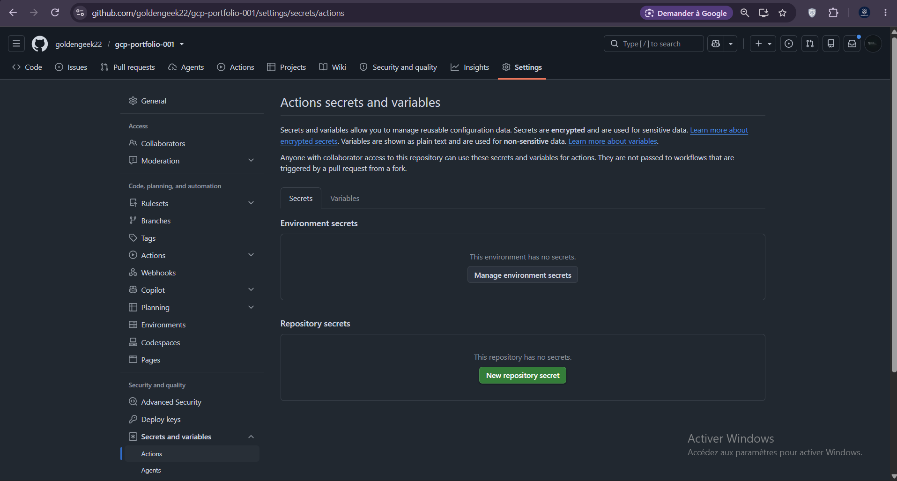

# 02 – Keyless CI/CD from GitHub Actions to Cloud Run

[](https://github.com/goldengeek22/gcp-portfolio-001/actions/workflows/deploy-tasks-api.yml)

**Problem:** deploying by hand is slow and error-prone, and the usual shortcut (a service-account JSON key stored in GitHub) creates a long-lived credential that can leak.

**Result:** every push to `master` that touches the API is linted, tested, built, pushed and deployed to Cloud Run in about 3 minutes. Pull requests run lint and tests only. GitHub holds **no Google credentials at all**: each run exchanges a short-lived GitHub token for 1-hour Google credentials.

**Workflow file:** [`.github/workflows/deploy-tasks-api.yml`](../.github/workflows/deploy-tasks-api.yml)

---

## Architecture



### Pipeline stages

| Stage | Runs on | What it does | Blocks deploy if it fails |
|-------|---------|--------------|---------------------------|
| `test` | push and pull request | `ruff check`, then `pytest` (Firestore mocked, no cloud access) | Yes |
| `deploy` | push to `master` only | authenticate via WIF → build → push → deploy → smoke test | – |

---

## Why Workload Identity Federation instead of a JSON key

| | Service-account JSON key | Workload Identity Federation |
|---|---|---|
| Stored in GitHub | Yes, as a secret | **Nothing** |
| Lifetime | Until someone rotates it | **1 hour per run** |
| If leaked | Works from anywhere | Useless: tied to this repo's token |
| Restrict to one repo | No | **Yes**, via `attribute-condition` |
| Rotation work | Manual | None |

The key security line is the **attribute condition** on the provider. Without it, any GitHub repository could ask Google to trust it:

```text
assertion.repository == 'goldengeek22/gcp-portfolio-001'
```

---

## Setup

Run once, in a bash shell (Cloud Shell works well). Replace the values with yours.

```bash
export PROJECT_ID=gcp-portfolio-001
export PROJECT_NUMBER=$(gcloud projects describe $PROJECT_ID --format='value(projectNumber)')
export GH_REPO="goldengeek22/gcp-portfolio-001"
export DEPLOYER=github-deployer@$PROJECT_ID.iam.gserviceaccount.com
export SA=tasks-api-sa@$PROJECT_ID.iam.gserviceaccount.com

gcloud services enable iamcredentials.googleapis.com sts.googleapis.com

# 1. Deployer identity with only what a deploy needs
gcloud iam service-accounts create github-deployer --display-name="GitHub Actions deployer"
gcloud projects add-iam-policy-binding $PROJECT_ID --member=serviceAccount:$DEPLOYER --role=roles/run.admin
gcloud projects add-iam-policy-binding $PROJECT_ID --member=serviceAccount:$DEPLOYER --role=roles/artifactregistry.writer
gcloud iam service-accounts add-iam-policy-binding $SA \
  --member=serviceAccount:$DEPLOYER --role=roles/iam.serviceAccountUser

# 2. Pool and GitHub provider, locked to this repository
gcloud iam workload-identity-pools create github --location=global --display-name="GitHub Actions"
gcloud iam workload-identity-pools providers create-oidc gh-provider \
  --location=global --workload-identity-pool=github \
  --issuer-uri="https://token.actions.githubusercontent.com" \
  --attribute-mapping="google.subject=assertion.sub,attribute.repository=assertion.repository" \
  --attribute-condition="assertion.repository=='$GH_REPO'"

# 3. Let that repository impersonate the deployer
gcloud iam service-accounts add-iam-policy-binding $DEPLOYER \
  --role=roles/iam.workloadIdentityUser \
  --member="principalSet://iam.googleapis.com/projects/$PROJECT_NUMBER/locations/global/workloadIdentityPools/github/attribute.repository/$GH_REPO"
```

GitHub **repository variables** (identifiers, not secrets): `GCP_PROJECT_ID`, `GCP_REGION`, `WIF_PROVIDER`, `WIF_SERVICE_ACCOUNT`. The **Secrets** tab is empty.

---

## Workflow highlights

```yaml
permissions:
  contents: read
  id-token: write          # lets the job request an OIDC token

- uses: google-github-actions/auth@v3
  with:
    workload_identity_provider: ${{ vars.WIF_PROVIDER }}
    service_account: ${{ vars.WIF_SERVICE_ACCOUNT }}
```

- **Images are tagged with the commit SHA.** Every running revision maps to an exact commit, and a rollback is "deploy the previous SHA".
- **`needs: test` and `if: github.event_name == 'push'`:** pull requests can never deploy, and a failing test or lint check stops the pipeline before anything is built.
- **Smoke test:** after deploying, `curl --fail` on `/health` turns an unhealthy revision into a red run instead of a silent outage.
- **`paths` filter:** only changes under `01-cloud-run-api/` (or the workflow itself) trigger a run.

---

## Evidence

### Green run: lint → test → auth → build → push → deploy → smoke test


### The gate works: a lint failure stopped the deploy


### The gate works: a failing test stopped the deploy


### Pull request: tests run, deploy is skipped


### Cloud Run revision tagged with the commit SHA


### Workload Identity provider locked to this repository


### Deployer service account: least-privilege roles


### No secrets stored in GitHub


> Screenshots go in `02-cicd/docs/`. Keep the file names or update the links.

---

## What I learned (real failures from building this)

| Failure | Cause | Fix |
|---------|-------|-----|
| `ruff` blocked the pipeline (`UP017`, `I001`) | `timezone.utc` alias and unsorted imports | `ruff check . --fix`; the gate did its job before anything shipped |
| `pytest` failed with `401 == 201` | The test asserted the wrong status for a request with no API key | Fixed the assertion; added a success-path test with a valid key |
| `setup-gcloud` failed: *project property must be a valid project ID, not [PROJECT_ID]* | The `WIF_SERVICE_ACCOUNT` variable held the literal placeholder `PROJECT_ID` | Replaced it with the real project ID |
| `docker push` failed: *Repository "portfolio" not found* | The Artifact Registry repo hadn't been created in `europe-west1` | Created the repo and re-ran the job |

Takeaways:

- A pipeline that fails early and loudly is working. Both lint and test failures stopped a bad build from reaching Cloud Run.
- Configuration values (variables, registry names, regions) are the most common source of CI failures. Next time I'd add a first workflow step that prints and validates them.
- Reading the exact error message pointed to the cause every time.

## What I'd change for production

- Separate `dev` and `prod` projects with GitHub **Environments** and a required reviewer before the prod deploy.
- Narrow `roles/run.admin` to `roles/run.developer`, and scope `artifactregistry.writer` to the single repository.
- Pin third-party actions to commit SHAs and let Dependabot propose updates.
- Scan the image (Artifact Analysis) before deploying, and deploy with `--no-traffic` followed by a gradual traffic shift.
- Automatic rollback when the smoke test or an SLO burn-rate alert fails (see project 5).

The pool, provider and service account cost nothing, so there is nothing to delete until the whole project is removed.