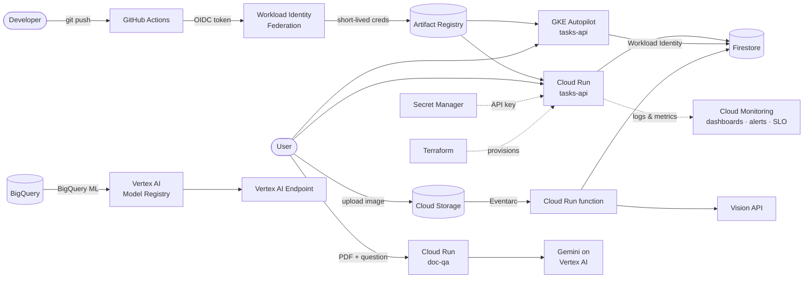

# Google Cloud Portfolio – ALEXANDRE AMEVOR

Nine hands-on projects that build and run real workloads on Google Cloud: serverless APIs, Kubernetes, keyless CI/CD, event-driven pipelines, observability, machine learning and generative AI. Everything here is reproducible from this repo with the commands in each project's README.

[](https://github.com/YOUR-USER/gcp-portfolio/actions/workflows/deploy-tasks-api.yml)


**Live demo:** [Tasks API docs](https://YOUR-CLOUD-RUN-URL/docs) · **Contact:** [LinkedIn](https://linkedin.com/in/YOUR-PROFILE) · your.email@example.com

---

## Projects

| # | Project | What it shows | Key services | Proof |
|---|---------|---------------|--------------|-------|
| 1 | [Containerized Tasks API](01-cloud-run-api/) | Containerize, deploy serverless, keep secrets out of code, least-privilege identity | Cloud Run, Artifact Registry, Cloud Build, Secret Manager, Firestore, IAM | [Live `/docs`](https://YOUR-CLOUD-RUN-URL/docs) |
| 2 | [Keyless CI/CD](02-cicd/) | Test → build → deploy on every push, no stored cloud keys | GitHub Actions, Workload Identity Federation | [Pipeline runs](https://github.com/YOUR-USER/gcp-portfolio/actions) |
| 3 | [Event-driven image labeler](03-event-pipeline/) | Serverless events, idempotent processing, pre-trained ML API | Cloud Storage, Eventarc, Cloud Run functions, Vision API | [Demo GIF](03-event-pipeline/docs/demo.gif) |
| 4 | [Kubernetes autoscaling](04-gke/) | Probes, rolling updates, HPA under load, Workload Identity | GKE Autopilot, HPA, Load Balancing | [Scaling recording](04-gke/docs/) |
| 5 | [Observability](05-observability/) | Dashboards as code, log-based metrics, alerts with runbooks, SLO | Cloud Monitoring, Cloud Logging, Uptime checks | [Dashboard](05-observability/docs/) |
| 6 | [SQL machine learning](06-bigquery-ml/) | Train, evaluate, explain and compare models in SQL | BigQuery ML, Vertex AI Model Registry | [Results](06-bigquery-ml/README.md#results) |
| 7 | [Custom model serving](07-vertex-endpoint/) | Version and serve a scikit-learn model behind a managed endpoint | Vertex AI Model Registry & Endpoints, Cloud Storage | [Request/response](07-vertex-endpoint/README.md) |
| 8 | [GenAI document Q&A](08-genai-doc-qa/) | Grounded answers with page citations, evaluation set, private deployment | Gemini on Vertex AI, Cloud Run, IAM | [Demo GIF](08-genai-doc-qa/docs/demo.gif) · eval **X/Y** |
| 9 | [Infrastructure as Code](09-terraform/) | Remote state, plan/apply, drift detection, one-command teardown | Terraform, Cloud Storage backend, Cloud Run v2 | [Plan & drift](09-terraform/docs/) |

> Vertex AI is now branded **Gemini Enterprise Agent Platform**; the APIs and `gcloud ai` commands are the same.

---

## Architecture



---

## Skills covered

| Area | Where |
|------|-------|
| Serverless compute | Cloud Run (1, 8), Cloud Run functions (3) |
| Containers & Kubernetes | Docker, Artifact Registry (1), GKE Autopilot, HPA, rolling updates (4) |
| CI/CD & DevOps | GitHub Actions, unit tests, SHA-tagged images, smoke tests (2) |
| Security & IAM | Dedicated service accounts, Secret Manager, Workload Identity Federation, Workload Identity for GKE, private services (1, 2, 4, 8) |
| Event-driven design | Eventarc, at-least-once delivery, idempotency (3) |
| Observability / SRE | Structured logging, log-based metrics, dashboards as code, uptime checks, alerting, SLOs (5) |
| Data & ML | BigQuery ML, model evaluation & explainability, Model Registry, online endpoints (6, 7) |
| Generative AI | Gemini via Vertex AI, grounding with citations, evaluation, cost tracking (8) |
| Infrastructure as Code | Terraform, remote state, drift detection (9) |

---

## Repository layout

```text
gcp-portfolio/
├── README.md                 ← you are here
├── env.sh                    ← shared variables (no secrets)
├── .github/workflows/        ← CI/CD for project 2 (+ Terraform checks)
├── 01-cloud-run-api/
├── 02-cicd/
├── 03-event-pipeline/
├── 04-gke/
├── 05-observability/
├── 06-bigquery-ml/
├── 07-vertex-endpoint/
├── 08-genai-doc-qa/
└── 09-terraform/
```

Each project folder contains its own `README.md` (problem, architecture, commands, evidence, lessons learned, cost and cleanup) and a `docs/` folder with screenshots.

---

## Run it yourself

**Prerequisites:** a Google Cloud project with billing enabled, the [gcloud CLI](https://cloud.google.com/sdk/docs/install), Docker, Python 3.12, and Terraform ≥ 1.6. [Cloud Shell](https://shell.cloud.google.com) has all of these preinstalled.

```bash
git clone https://github.com/YOUR-USER/gcp-portfolio.git
cd gcp-portfolio

gcloud auth login
gcloud auth application-default login
gcloud config set project YOUR_PROJECT_ID

source env.sh        # sets PROJECT_ID, PROJECT_NUMBER, REGION, REPO, IMAGE
```

Then follow the projects in order: 1 → 2 → 3 → … → 9. Projects 2, 4, 5 and 9 build on the API from project 1.

---

## Cost & cleanup

I ran everything in a dedicated project with a **$10 budget alert**. Total spend for the whole portfolio: **$X.XX**.

- Cloud Run services scale to zero, so the live demos cost nothing while idle.
- The GKE cluster (4) and the Vertex AI endpoint (7) bill while running, so they were deleted the same day. The commands are in each project's README.
- Everything can be removed with `gcloud projects delete $PROJECT_ID`.

---

## What I'd add for production

- Separate `dev` and `prod` projects, both deployed by the same pipeline with manual approval for prod
- A custom domain with an external HTTPS load balancer and Cloud Armor in front of Cloud Run
- Every resource managed by Terraform and applied only from CI
- Retrieval (RAG) with embeddings for project 8 once the document set grows beyond a few hundred pages
- Canary releases with automatic rollback driven by the SLO burn rate

---

## About me

ONE OR TWO SENTENCES: your background, the role you're targeting, and what you enjoyed most building this.